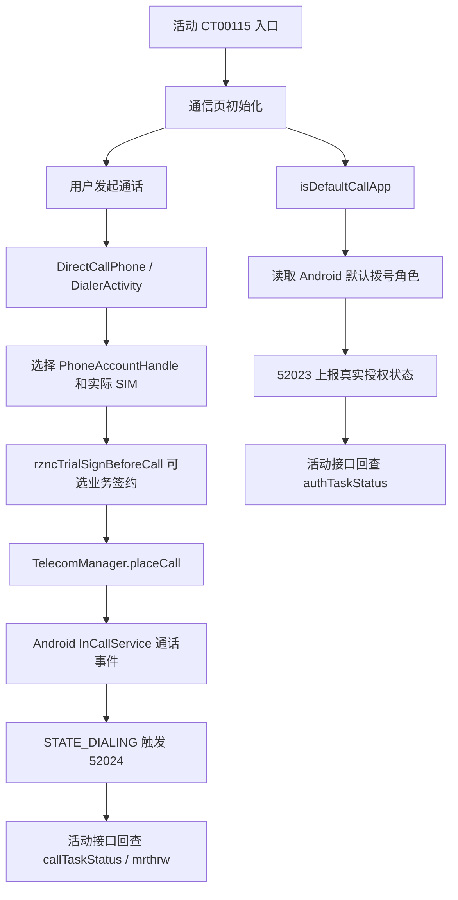

# APP 通话组队

2026-11-27 通过海报二维码定位官方活动 `1026112045`，使用 REA 与 JS 工具核对当前前端。工作台入口为 `/native-group`，官方入口为 https://wx.10086.cn/hlwyxhdhub/act-nativeGroup/1026112045 。

## 官方条件

当前业务接口返回活动时间为 2026-11-24 至 2026-12-31。以业务接口及规则正文为准，规则容器外层的配置时间范围不同。

| 队伍人数 | 全队话费券总额 | 每人话费券 |
| --- | --- | --- |
| 3 | 3 元 | 1 元 |
| 5 | 15 元 | 3 元 |
| 10 | 100 元 | 10 元 |

须满员且全员完成任务，按完成先后及库存发奖。安卓要求首次将中国移动 APP 设置为默认通话应用，随后在入队后完成至少 5 秒有效通话。iOS 要求端内有效通话。APP 需 12.5.4 或以上，通话按现行资费计费。活动期间每号仅能加入一个队伍，仅尚未邀请其他队员的创建人可以退出。

## 接口与认证

同域 APP SSO 使用当前共享账号 Cookie，认证后通过 `userInfo` 核对手机号及 `app` 渠道。活动认证域与既有签到业务分别缓存，普通查询、程序重启及主登录版本变化均复用已有有效活动凭据。官方明确判定只读会话失效时有界恢复一次。未提供期限的 opaque 活动令牌不自行设置到期时间。

API 前缀为 `https://wx.10086.cn/hlwyxhdhub/api/nativeGroup/`，当前均使用 POST JSON，包含 `login-check: 1`。

| 接口 | 参数 | 用途 |
| --- | --- | --- |
| userInfo | 空对象 | 账号核验 |
| activityInfo | osType | 活动资格、队伍、奖励状态及抽奖次数 |
| myPrizes | 空对象 | 官方奖品记录 |
| drawTasks | osType | AI 实时字幕及体验反馈任务进度 |
| createGroup | groupSize、osType | 创建 3 / 5 / 10 人队 |
| joinGroup | inviteToken、osType | 使用官方邀请加入队伍 |
| quitGroup | 空对象 | 允许条件下退出队伍 |
| redeemGroupAward | 空对象 | 达到官方条件后领取组队奖励 |
| shareTextInfo | 空对象 | 获取分享图片及文案，不返回邀请码 |
| generateInviteToken | riskConstId | 获取当前队伍的官方邀请码 |

页面中的建队、入队、退队、领奖和批量组队均先确认，再查询最新进度。改变成员关系或领奖前写入加密的持久化提交标记，收到结果后回读官方状态。结果未知时只查询，不重放提交。批量组队保留原确认名单，中途失败后继续原方案，跳过已经核对完成的成员关系。

号池规划先核对有效身份、官方资格及已有队伍，优先分配 10 人队，余号用 5 人、3 人组合并尽量减少落单。例如 13 个可参与号码为 10+3，16 个为 10+3+3，18 个为 10+5+3。已入队、资格不足或结果待核实的号码不会被重新分配。

## 当前验证与边界

- REA 静态分析了官方 `index.T18cWykC.js` 及 `vendor/hooks.BbPJQOeP.js`，并对提取的 1604 字符协议片段进行了重点分析。原始大文件图存在预算及动态调用未知项，未将其当作全量覆盖证明。
- JS 工具在离线上下文核对了读取、建队、入队、领奖及分享函数的 URL、POST 方法和参数，运行期接口逻辑全部使用 Python。
- 当前号池 13 个账号的身份、资格及进度已通过官方只读接口核对，预览为 10 人队加 3 人队。组队及领奖写操作由本地页面确认后提交，当前开发验收未消耗成员关系或领奖次数。
- 27 项活动及平台回归通过，覆盖人数规划、确认入口、账号状态、提交后读回失败、重启核对及批量中断续接。工作台页面已用隐藏浏览器核对，预览展示 10+3，页面无横向溢出。
- 原生通话任务由 `cmcc.goNativePage` 的 `CT00115` 入口承载，尚无独立 Python 的通话授权及真实有效通话流程。体验反馈进入独立小程序，实际反馈提交尚未接通。页面保留官方未完成状态，不调用 `finishDrawTask` 代替实际操作。
- 抽奖接口及另一条二维码邀请路径包含 `riskConstId`。Python C1 认证现已通过官方校验，抽奖请求与次数回查已接入，真实抽奖及中奖发放仍待可用机会验证。详见下节。

官方生产主 JS 的 SHA-256 为 `5c3c9cf174417a5863b14921178ab9c29680c475de57ff460a6fe29c9a3ad1b0`。不含个人凭据的分析材料位于忽略提交的开发目录，账号、活动凭据和记录位于 `%LOCALAPPDATA%\LingxiWorkspace\data` 的加密存储。

## 2026-11-27 接续验证

活动使用 ConstID `1.1511.0.1973`，应用标识为 `9e11b6f9f78e14953febc4e3ce2ea609`，认证端为 `yxfk.market.chinamobile.com:8081/mgt/decision-engine/udid/c1`。该标识与现有周三充值日相同，可按同一账号复用官方设备标识，继续使用现有 Python 的 JSON/CESU-8/自定义 Base64 编解码。

0314 的轻量缓存请求要求补充环境信息。随后仅提供实际 Python 用户代理、Windows 平台、实际时区、CPU 并行度及 SDK 对应的环境分支值，官方返回 HTTP 200、`status=2` 和 40 字符有效凭据。未使用浏览器计算或手机即时取值。有效凭据已按账号加密保存，未给未声明期限的凭据套用其他活动的 TTL。

新增 `device.py` 复用 `DeviceSession`，合并同账号并发准备，持久化失败时保留设备标识。缓存命中、程序重启及主登录凭据版本变化不重新请求 C1。该认证使用独立 HTTP 会话，避免覆盖活动业务会话的绑定。

`doDraw` 的正文按官方 JS 使用 `riskConstId`。提交前重新检查机会数及每日最多 2 次的上限，先记录提交意图，提交后核对剩余次数、当日已抽次数和官方奖品记录。非成功业务响应也可能意味着机会已使用，因此保留待核实标记，先查询再决定后续操作。当前号池 13 个号码的已核对记录均为 0 次机会，两项原生任务均尚未完成，本次未实际抽奖，也未宣称获奖。

REA 核对当前 APK 的 `com.dialer.services.CallService`，其声明 `BIND_INCALL_SERVICE` 权限并承载 `android.telecom.InCallService`。APP 的默认通话角色属于系统能力。当前 APK 的可见 DEX 只有 8 个加固壳类，未取得真实拨号、授权统计或通话回传实现。Manifest 观察只证明组件声明，不能单独证明底层所有通话实现。随后已连接手机，获用户授权后只读取并验证本人 0314 的 APP 凭据，同步至外部加密账号存储，保留已有活动会话；手机仅用于开发核对及一次性同步。

体验反馈指向小程序 `7708388161516027`。已取得其官方中转 JS，当前只包含客户端启动和版本判断，未提供反馈表单及提交接口。mPaaS 官方文档说明离线包信息通过 `alipay.client.getUnionResource` 获取，随后下载对应包。目前没有该业务包及其加载请求，不能用其他 APP 的样例参数推断本活动接口，也未用 `finishDrawTask` 代替反馈提交。[mPaaS 官方加载说明](https://help.aliyun.com/zh/document_detail/191181.html)

反馈入口另有通用换票调用 `user/appendYDRZToken`。只带本活动的 `HLWHD_SESSION_TOKEN` 时，该接口返回 `GOTO_LOGIN`，同时本活动 `userInfo` 仍有效。仅增加同账号已有的兼容 `QWHD_SESSION_TOKEN` 后，换票接口返回 `SUCCESS`，目标仍为小程序中转页。因此这个错误属于通用入口所需的另一份会话，不据此强制续期仍有效的通话活动身份。当前仍未取得反馈小程序业务页及其提交接口。

实际观察到的本活动 Cookie 名为 `HLWHD_SESSION_TOKEN`，已将缓存期限策略改为读取此 Cookie。此修正保留原凭据、绑定及获取时间，不因策略修正重复登录。

当前 37 项活动及平台测试通过，补充覆盖认证缓存复用、并发合并、失败标识保留、真实环境字段、正确活动 Cookie 的期限策略、零机会不提交、每日上限、非成功响应保留意图及重启后抽奖次数核对。工作台的准备认证入口已返回成功；零机会抽奖请求在本地返回 `DRAW_UNAVAILABLE`，未向业务端发送抽奖提交。

## 邀请信息修正

邀请弹窗报“官方尚未返回有效邀请信息”的原因是将 `shareTextInfo` 的图片、文案配置误当成邀请码。官方前端另行调用 `generateInviteToken`，正文包含有效 C1 凭据 `riskConstId`，成功响应的 `data.inviteToken` 才是入队凭据。已按此调用链修正，并用 URL 编码构造活动邀请地址。

0314 已有 10 人队、当前 1 人。真实 Python 请求获取邀请码成功（HTTP 200、业务 `code=0`），证明该账号缓存的 C1 凭据通过此业务接口验证。未重复建队，未替其他账号入队，也未将生成邀请当作通话任务完成。活动及平台共 40 项测试通过，增加独立邀请码接口、缺失字段不得用文案配置替代、无队伍不初始化认证和邀请码编码回读覆盖。

## 手机流程与机型限制核对

已通过工作台正常 `/api/native-group/run` 入口再次生成 0314 邀请，返回有效官方邀请码和最新页面状态，链接编码后可回读同一个邀请码。0314 的主登录同步已落库并由重启后的服务读取，保持原账号 ID、其他账号及独立活动凭据不变；没有额外发送短信。

当前手机型号为 `2210132C`，中国移动版本 `12.5.6`。在 APP 搜索“组队赢100元话费”进入活动后，页面显示“本次活动仅限部分机型用户参与”。官方前端通过 `cmcc.getUserInfo` 的 `osType`、`sn` 判断：iOS 或安卓型号在 `Zf` 名单内才显示主页面，当前源中的名单有 806 项，不包含该型号。这个页面判断与已成功的 Python 活动查询、邀请接口是两个层次；未将接口成功解读为原生通话条件已满足。

手机当前单 APK 的 SHA-256 为 `eea917758f244e285d187325fdccf480d0737be2cdc4a1fac9b3688bf879b754`，与之前下载的分析样本不同。REA 对两份 Manifest 的精确组件检查显示：两者均声明 `com.dialer.activities.DialerActivity` 和 `com.dialer.services.CallService`，但手机包中这两个组件的 actions 为空，之前样本则注册 DIAL、CALL、OPEN_DIALER 及 InCallService 等动作。手机执行正常 OPEN_DIALER intent 无匹配；显式打开已导出的 DialerActivity 能送达，但界面随即提示“未知错误”并返回原页面。此结果仅证明本次启动未成功，不能据此认定具体实现缺失或猜测需要的初始化参数。当前默认拨号应用仍为系统通讯录，未修改默认通话角色、未拨打电话、未伪造通话或任务回执。

已由开发工具操作手机，通过 APP 扫描官方公开反馈入口，打开 scene=18 的“通信意见反馈”小程序。取得其真实业务包 `7708388161516027.tar`，SHA-256 为 `784e9e0e1a797d3574109b01acf346f1f4dc51c63cbb085db73c8a6cb3e45149`，包含反馈页、反馈列表和详情页。JS 中实际提交函数为 `upFeedBackInfo`，使用 `feedBackScene=18`、反馈类型、用户填写的问题描述等字段，成功需 `retCode=000000` 且 `flag` 非 0。当前仅取得并分析业务包，没有填写或提交意见，也没有将打开小程序计为任务完成。临时二维码文件已从手机删除，相机与媒体权限授予状态经前后核对一致。

## 原生入口报错归因与真实任务上报

继续分析时，对手机进程中 `libdatajar.so` 的代码映射作只读读取，提取到 24 份 DEX，全部通过自身 SHA-1 校验。未附加调试器、注入代码或使用 Frida。原始运行时代码和分析证据保存在项目外数据目录的 `development/native-group-phone`，仅在本机将这些 DEX 与已安装包的 Manifest、资源组合为分析容器，从未安装该容器或修改手机 APK。

REA 已取得 `DialerActivity.onCreate` 和 `goDialpad` 的完整反编译结果，修正此前对“未知错误”的判断：没有 action 的显式启动必然落入报错分支；`DIAL` / `VIEW` 还要求有效的 `tel:` 数据。使用正确的 `DIAL` 和仅预填的 `tel:10086` 后，已实际打开 `DialpadActivity`，没有触发拨号。因而“缺少隐式 intent 注册”和“空参数启动报错”不能证明原生通话实现不可用。页面打开的开发验证同样不等于纯 Python 任务完成。

`CT00115` 在 `ApptableAssistant.skipPushPage`、`PushDispatchActivity.goTarget` 中对应首页导航的“通信”页，需要该导航出现在下发的 tab 配置。当前手机直接分发此功能码会回到首页。独立拨号页与这个首页导航入口是不同路径，分析及产品提示应区分。

已定位两条与营销活动有关的真实原生上报链路：

| 链路 | 来源与语义 | 当前处理 |
| --- | --- | --- |
| `52023` → `/DN/call/cson/appinfo/isCallGrant` | `IsDefaultCallApp.invoke` 先读取真实 Android 默认拨号角色，再发送 `cellNum` 和 `callGrant`。虽然 SDK 方法名像查询，其内部含上报写入。 | 不作为普通查询或轮询执行，不把 false 改写为 true。 |
| `52024` → `/DN/call/cson/appinfo/lastCall` | `CallService.onCallAdded` 在真实 `android.telecom.Call` 进入拨出状态时调用 `checkAndUploadCallInfo`，请求体类型 `UploadCallInfoReqBean` 包含 `cellNum`。 | 没有真实通话事件时不补造上报。该字段结构及触发点并不能证明服务端如何核验至少 5 秒的通话。 |

设置默认拨号应用使用 Android `RoleManager.createRequestRoleIntent`，结果回调还会重新读取实际系统状态；纯 Python 的 HTTP 成功响应不能替代系统角色授权。现阶段尚未取得可以脱离 Android 真实通话事件、独立完成有效通话任务的受支持协议流程。

验证结束后的回查发现，0314 的平台主登录已失效且活动 Cookie 已按其官方期限过期。已再次核对手机当前 0314 会话、通过一次官方 APP 验证并同步到原账号记录，保留其他账号和独立会话。恢复活动登录后，真实只读回查确认：10 人队仍为 1 人，成员授权及通话状态均为 null，`mrthrw`、`sytyfk` 均为 0，抽奖机会为 0，没有不确定提交或领奖成功记录。未据开发页面打开情况改写完成状态。

## 完整链路续查与 Python 独立验证

### 请求封装及通信页初始化

REA 已核对 `CommonHttp.getEntity`、`requestData`、`createHttpHeader`：使用同账号既有 APP Cookie、XK，完整请求外层包含真实号码与省市，`reqBody` 承载业务参数；`xs`、`x-token`、`x-sign` 与现有 Python APP 网关实现属于同一套算法。普通请求不重新获取 XK，也不强制登录。当前目标的两个上报请求使用这套公共 HTTP 封装，本次没有执行上报写入。

从手机取得通信页实际业务包 `call-1795596169.jsbundle`，SHA-256 为 `006a6af265cc67ec8a6d1b606e3ebf43364d9ad62957d32a1091f54b0fcbb4c5`。这是 Hermes v94 字节码，使用开发工具 [hermes-dec](https://github.com/P1sec/hermes-dec) 0.1.8 进行离线解析，未执行目标业务代码。工具仅解包至忽略提交的开发工具目录，没有加入平台运行依赖。

通信页函数 #2178、#2182 在 Android 分支调用 `isDefaultCallApp()`，随后分别查询欢迎配置和任务提示。这也证实营销授权上报使用的是 `IsDefaultCallApp`；另一个名称接近的 `IsDefaultDialer.invoke` 只返回本地角色状态，没有该上报。两个方法不能混用。

已解析 HTTP 导出模块 #870 与封装函数 #974，明确请求体实际会注入 `cellNum`、`provinceCode`、`cityCode`。两个只读路径分别是：

- `/biz-orange/DN/call/cson/nativeCallAct/queryNewVersionWelcomePage`，另外携带客户端分支的 `sceneType`。
- `/biz-orange/DN/call/cson/nativeCallAct/queryNewVersionPrompt`，调用方参数虽为空对象，但公共封装仍注入上述三个账号字段。

首次 Python 只读验证未加公共业务字段时，响应为 HTTP 200、`retCode=310000`（请求参数不合法）。根据字节码证据补齐字段后，同一账号和既有凭据的请求返回 HTTP 200、`retCode=000000`，`rspBody=null`，没有旋转 Cookie。因此已验证独立 Python 的传输、加解密和请求形态被该接口接受；返回空数据不能当作任务完成或已取得可领取奖励。

### 实际授权与拨号路径

`DialerActivity.initOutgoingCall` 先校验拨号权限，选择实际 `PhoneAccountHandle`，把所选 SIM 交给通话准备逻辑，最后由 `TelecomManager.placeCall` 发起通话。`DirectCallPhone.doCall` 也是启动 Android `CALL` intent；其“拨号成功”仅表示 intent 已发出，不代表接通或通话达到 5 秒。

`rzncTrialSignBeforeCall` 会比较登录号码与所选 SIM；条件不满足时跳过该业务签约并继续拨号。签约的成功、失败回调都会继续进入系统拨号，因此该 SDK 签约不是一个可独立代替实际电话的 HTTP 呼叫服务。

`CallService.onCallAdded` 与 `CallService$callListener$1.onStateChanged` 都能在 `STATE_DIALING=1` 时触发营销通话记录；同一个 Call 对象通过 `reportedDialingCalls` 去重。接通 `STATE_ACTIVE=4` 和断开 `STATE_DISCONNECTED=7` 有独立分支，断开统计带有通话时长。已看到的 `52024` 上报发生在开始拨号阶段，请求体只有号码，不能据此证明服务端是否、以及怎样结合其他记录核验至少 5 秒有效通话。本次没有真实呼叫样本，也没有伪造该事件作正向领取实验。

包内还存在通用 `startVoipVoiceOrVideo` 桥接，依赖融合通信业务插件、业务 appKey/companyId 等上下文；它与本活动已观察到的 Android 系统拨号主流程不同。目前没有证据证明这条通用 VoIP 路径会计入本活动授权或有效通话，未将其视为已经可用的替代方案。

### 可重复核对及当前结果

开发工具 `.local/native-group-audit/verify_call_chain.py --account 0314` 仅用 Python 与本地工作台及官方只读接口交互，最终运行不调用手机、ADB、浏览器或 WebView。该工具复用当前账号凭据，保留服务端空值，不调用 `isCallGrant`、`lastCall`、签约、拨号、抽奖或领奖写接口。它是链路验证工具，不是已完成的无人值守授权/通话执行器。

本轮实际运行结果：通信页只读请求 `retCode=000000`、`rspBody=null`、Cookie 未变化；活动官方回查显示 0314 成员的 `authTaskStatus=null`、`callTaskStatus=null`，`mrthrw=0`、`sytyfk=0`、`drawTimes=0`，没有不确定提交。完整验证回执加密保存在统一数据目录的 `development/native-group-phone/verification-*.bin`。

当前能够独立执行并验证的是登录凭据复用、接口签名、只读进度查询和已有组队/邀请操作。仍缺少脱离 Android 系统角色及实际通话事件、同时满足本活动真实条件的受支持操作流程；不能将两个事实记录上报接口当作授权和发起电话的接口。此结论限定于已取得并分析的当前 Android 活动与客户端链路，不声称覆盖服务端内部校验或其他客户端的全部实现。

## 满员后两项任务与融合通信路径复查

用户组队后，本轮最初成功读取官方进度，0314 所属 10 人队已满员，10 位成员均为 `osType=android`；所有成员的 `authTaskStatus`、`callTaskStatus` 均为 null，授权及有效通话完成数均为 0。分析结束时再查，官方 APP 活动认证返回 `FAILED`，本地接口返回 HTTP 502，未取得更新的官方进度。因此两项皆为 0 是最近一次成功回查的结果，不是末次失败请求的新结果。未反复认证、强制续期共享 APP 身份或改写已完成标记。

为核对真实独立通话路径，继续追踪了以下调用，全部为已取得代码的静态分析，没有在手机执行授权、拨号或任务上报：

1. `StartVoipVoiceOrVideo.invoke` → `WebViewModuleBridge.startVoice_vm` → `DefaultWebViewModuleImp.startVoice_vm`：依赖融合通信插件、业务 appKey、companyId、用户号码及对应业务配置。
2. 插件 `PluginRongheAvActionImpl.startVoice` 构建 `BasicChannalInfo`、`InterfaceServiceUserInfo` 后调用 `VoipVideoVoiceUtil.startVoipVoice`。这是一条实际存在的独立 RTC 功能入口，尚不能据入口存在判断其通话会计入本次组队营销任务。
3. `PluginRongheAvActionImpl.getCmosSdkOauthToken` 委托 `VoipJsUtil.getCmosSdkOauthToken`。当前可见后者实现为 `NCall.IV(new Object[]{955, this, context, targetChannelId})`，尚未还原其原生虚拟化授权逻辑或完成独立 Python 的 SDK 登录。
4. `RtcVoipApi.makeCall` 是抽象接口，实际实现 `VoipModule.makeCall` 依赖已初始化的 `mStateMachine` 并委托其处理 `RtcCallParams`。尚无独立 Python 的注册、信令、媒体通话和实际营销计入验证，不能把 Java 方法名当作已经掌握网络协议。

另外，RN 字节码 #876 对应 `/biz-orange/DN/call/cson/meet/sdk/getSdkUserStatus`，#3847 在会议模块 #3837 中导出为 `checkUserStatus`。按公共账号字段进行一次 Python 只读探测，HTTP 200，返回 `retCode=110000`（请求暂时无法受理），无业务数据、无 Cookie 旋转。这个响应没有给出具体拒绝原因；该接口属于会议模块，也不能据此认定融合语音 SDK 未注册或本活动不符合资格。未对该请求进行自动重试或强制重新登录。

当前结论仍为两项任务未完成：Android 默认拨号授权的真实系统状态不能由 HTTP 记录上报替代；融合 RTC 路径尚未取得完整可独立运行的授权和呼叫协议，也未证明能满足当前 Android 队员的任务条件。相关新证据、最近一次成功回查及末次认证失败记录分别保存到外部数据目录，不改写任务完成标记。

## REA 深层分析接续记录

用户要求持续使用 REA 分析，目标仍为真实完成通话授权及有效通话，最终运行不依赖手机，不以事实记录上报替代实际操作。

### 会话阻碍与恢复

本轮读取手机当前原始会话，在内存独立会话中进行有界对照：原始会话、执行一次 Python 保活后的会话、保活后仍用原始会话，均能通过官方活动 SSO 并读到 10 人队。本次保活没有改变 Cookie，因此没有证据支持“此次失败由保活覆盖 Cookie 引起”的假设；账号池保存的旧会话与当前手机会话不同。

REA 跟踪 `LoginManager.requestAuthLogin`、`saveUserInformation`、`LoginInfoManager.get/saveNewLoginInfo`，确认原生可从 `LoginInfo.refreshToken` 续期。手机当前 `currentLoginAccount` 未保存此字段。选用最近一份完整、同账号同设备上下文的旧工作台备份做一次官方续期，返回 `400007`，没有继续试更旧令牌或发送短信。

用户随后在工作台正常重新登录 0314。已读取到完整设备上下文和新的续期令牌，账号修订为 3464；直接复用新凭据恢复了官方活动查询，10 人队授权完成数、有效通话完成数仍均为 0。没有再用手机会话覆盖这份可独立续期的工作台身份。验证回执位于外部数据目录的 `after-workbench-relogin.bin`。

### SDK 登录契约与桌面分支

REA 已核对 `AccountModule.login`、账号状态机 `account.b.a(RtcAuthParams)`、`AccountNativeWrapper.connectToServer`：SDK 要求初始化成功、注册连接回调、合法账号参数，并使用账号、province、token、appKey、deviceType、deviceId、networkType、loginType、authType、timestamp、sig 等字段连接 CCP。`sig`、`timestamp` 缺失时直接拒绝连接，不等于一次普通 APP Cookie 请求。

`RtcDeviceType` 明确声明 `PC`、`WEB`、`MAC`，此外还有 Android、iPhone、iPad 等类型。这证明 SDK 的设备类型包含桌面/网页，但不证明当前业务 appKey 允许它们，也不证明其通话会计入本活动；尚未猜测枚举数值或构造已授权状态。枚举初始化与部分授权适配方法同样封装在 `lte.NCall` 中。

### VMP 静态恢复进度

- `lte.NCall` 静态初始化加载 `GameVMP`。插件 ARM64 解释器 `libGameVMP.so` 为 215936 字节，SHA-256 为 `6152cf1e79af5708805cbed2a5a7e0f18351ebbdfb5e34d69363b70173a23eaa`；`libGameVData.so` 为 339417 字节，SHA-256 为 `aa6dc527ee5ec1f8be91b76c1b1c9678b9a66cf79f65dd72b50619da40169464`，魔数为 `ivmp\n02`。
- 当前 REA Windows 原生提供器不支持 ARM64 ELF，且其 Ghidra 后端未配置；Android/JADX 工具仍正常工作。已按诊断改用本机既有 Ghidra 11.4.2 命令行补充离线分析，没有安装/升级引擎或修改 MCP 全局配置。这部分结果是普通 Ghidra CLI 观察，不伪称 REA 原生 Evidence。
- 从已加载库只提取了可执行及只读代码映射；没有复制堆、可写应用状态或注入手机。后来手机 APP 进程退出，后续继续用已取得的代码和原始 ELF 做离线推导，没有为此重新调起手机 APP。
- 解释器原始 ELF 的部分头表隐藏了有效符号/代码范围。对分析副本重建段映射后，已识别 `JNI_OnLoad`、导入的 `inflate`、文件读取等函数。分析副本从未用于实际业务执行或安装到手机。
- 按 ELF 重定位静态恢复了 1226 个相对地址项；其中一个分支常量与此前只读观测的代码分支元数据一致。已对 JNI 初始化恢复 20 个固定跳转及一个保留 EQ/NE 条件的分析辅助跳转；对数据入口恢复 32 个固定跳转，剩 4 个动态分支使用已知表目标进行分析注解。
- 验证了 19 组相同的循环 XOR 字符串解码函数，已用 Python 还原 390 条静态标识。完整解码结果加密保存在外部数据目录 `vmp-decoded-static-strings.bin`。这不是个人登录令牌或已经取得的 SDK 业务授权。
- `libGameVData.so` 头中声明的展开文件长度为 848294，目前尚未取得完整有效的展开数据。对已知字符串 XOR 键的离线压缩探测没有成功还原完整数据；一个仅能展开 1 字节的前缀已按长度与完整性不符剔除，未视为成功。

当前离线分析材料位于忽略提交的 `.local/native-group-audit/voip-native`，包括原始代码哈希、重定位及等价跳转重建清单、分析副本和 Ghidra 输出。继续的具体入口是数据文件读取函数（相对地址 `0x43e98`）、跳转表 `0x5b620`、掩码 `0x6bf6abb9`；先恢复完整数据解析，再核对编号 955 授权适配与 SDK 桌面认证。两项任务没有因此标记完成。

## 2026-11-27：完整数据解码及授权入口纠正

本节更新上一节“数据尚未完整展开”的状态，原始输入与失败实验保留。通过 Ghidra CLI 离线还原 `0x43e98` 文件加载、`0x421f8` 前缀 XOR、`0x1a658` 摘要包装与 `0x1a9a0` 压缩轮函数，确认该版本使用修改过 26 个轮常量的 MD5。不能用标准 MD5 或字符串 XOR 键替代它。Python 还原后，zlib 流完整结束、无多余压缩字节，合并头部的长度为 848294，SHA-256 为 `3d77a656775a28bf5e399348f8a026f840cc7aa62dbb570942a626ab06544e3a`。纯 Python 解码工具与完整性回执位于忽略提交的开发分析目录，未运行、安装或修改目标客户端。

解析得到 8429 条字符串、6117 个方法引用、2851 个代码项。代码项 955 确实对应 `VoipJsUtil.getCmosSdkOauthToken(Context,String)`；但该代码项总长只有 20 字节（16 字节头和 4 字节指令区）。本版本中不能凭方法名把它当作可调用的令牌申请接口。JNI 注册链 `0x18aa0 → NCall.IV(0x19440) → 0x21ec4 → 0x220f4` 已定位；解释器按指令字节、代码项编号及 PC 解码操作码。955 的首操作码为 `0x1c`，静态分派到 `0x254c4`，只设置返回标记并经 `0x27a8c` 返回，没有发出认证请求。该结论限于本次插件哈希，不能外推其他版本。

REA/JADX 继续在主程序代码中找到了实际音视频认证链：

- `HostService.getAuthToken` 所依赖的主程序 `com.cmcc.oauth.Oauth.getAuthToken` 读取 `cmos_sdk_oauth_authToken`；这不是共享 APP Cookie。
- 主程序 `Oauth.initSdkOauth → beginRequest` 走真实 APP 身份换票。`NativeSdkImp.getYDRZToken → CommonH5GetYDRZTokenHelper.getYDRZToken_r` 使用业务编号 20086，路由为已有 Python 实现使用的 `getBigNetToken`，参数含 `sourceId`、`url`、`cellNum`，可带 `appId`。
- `com.cmcc.oauth.a.b.a(...,SdkOauthCallback)` 再调用 `wmhopenapi/sdkAuth/domain/login`。该协议使用 SDK appKey/appSecret、有效业务票据、JWT 和独立的请求加密头，不能把普通 APP Cookie 直接填到 RTC 的 token/sig。
- 对应 REA 证据包括 `ev_f89ceb561e55b60f21a510efc752bbdeec1daa1797605f30862370ab07bb3134`、`ev_08953f328a88ab7fcf9bd7e66c467d31c3f9b5865adf2a8e942bf6d910b9540c`、`ev_e66a604851fbe0ec16c4b0006d40ee367cf9ddcc339f608786d94958ca0e4758`、`ev_6a5bfb01369f23ea3cbfac8db1185e4f30f00c524b449553cca06455d2897953`；所选源码及来源加密保存为外部数据目录的 `development/native-group-phone/rtc-sdk-source-evidence.bin`。

一次性核对手机缓存时，当前原生账号确认为 0314，但 `cmcc_oauth_config.xml` 的磁盘内容不是明文 XML。未把无法解析的数据当作 SDK 登录态，未导入不明所属令牌，也未覆盖用户新建立、含续期凭据的工作台主身份。此处尚未建立可在桌面独立续期并真实发起通话的 RTC 会话。

再次运行纯 Python 只读验证，官方返回完整 10 人队，10 位成员的 `authTaskStatus` 和 `callTaskStatus` 仍全为 null，`mrthrw=0`、`sytyfk=0`、抽奖机会为 0，无不确定提交。通信页只读接口返回 `000000`、空数据，Cookie 未变化。回执为外部数据目录中的 `verification-1795790653385698400.bin`。新 APP 登录已恢复，但两项任务均未完成，且未发送正向授权/通话上报、实际电话或领奖请求。

剩余边界：Android 授权要求真实系统默认拨号角色；Windows 上的 Python HTTP 请求不能设置手机系统角色。真实手机初始化尚待用户对先前一次性授权选项的答复，且即使完成，也不能计为纯 Python 授权实现。独立通话还需要完整的合法 SDK 认证、桌面信令与媒体流程，以及本活动实际计入结果；当前尚无真实通话样本证明通用 VoIP 会计入原 Android 组队成员的任务。

## 一次性真实授权及独立 Python RTC 身份

用户随后明确允许一次性在手机完成真实授权；此授权已执行，不应再次要求同一授权。最终通话运行仍不得依赖手机。

### 已由官方确认的授权结果

手机原安装包来自小米应用市场，虽然与完整包同为 12.5.6，但没有 DIAL 意图及可用 InCallService，系统默认电话候选列表不包含中国移动。已用本机 Android `apksigner` 实际验证两个 APK 的 v1/v2/v3 签名，版本码均为 125600，v3 证书指纹均为 `f1643b0985914ac0d6d05e8ee4646a1a8649469e56fbbfebb711d7b6aacf9a2d`。在用户许可的真实授权范围内，以完整同版本同签名 APK 保留数据覆盖安装，没有卸载或使用强制降级。

覆盖安装后，系统能解析 `com.dialer.activities.DialerActivity` 与 `com.dialer.services.CallService`。经系统“默认电话应用”页面选择中国移动，`cmd role get-role-holders --user 0 android.app.role.DIALER` 实际返回 `com.greenpoint.android.mc10086.activity`。未通过 root 强行赋予系统角色，未拨打手机电话。手机最终返回桌面，默认电话仍为中国移动。

平台 0314 的有效 APP 身份与手机既有 `device_id`、XK 匹配；使用这份可续期身份进行 Python 同步，没有用手机的 GUEST 身份覆盖工作台。第一次请求使用了 getter 名称 `callGrant`，接口虽返回 `000000`，任务状态未变。REA 核对 `CallServiceInfoRequestBean.getCallGrant()` 上的 `@JSONField(name="isCallGrant")` 后，按正确字段、实际已验证的系统角色同步，接口再次返回 `000000`；随后的官方活动查询将 0314 的 `authTaskStatus` 确认为 `"1"`。

因此已完成的是“一次性真实手机授权 + Python 同步 + 官方回查确认”，不能记为纯 Python 设置 Android 系统角色。当前 10 人队其余 9 位成员的授权仍未确认，所有成员的有效通话仍未确认。两份提交回执分别保留，未在不确定状态下重放：`dialer-grant-0314-20261127.bin`、`dialer-grant-0314-native-field-20261127.bin`；成功回查为 `verification-1795792044682677700.bin`。

### 已成功的纯 Python SDK 认证与租户参数

主程序 `ThreeBizSdkRongheVoiceAndVideoImpl.doAction(initOauth)` 提供 SDK 客户端配置。已在 Python 中实现其业务换票、查询签名、AES-CBC 请求/响应封装、SHA-256、RSA 请求密钥封装及 SDK/APP 两层 JWT 头；AES 和查询签名还与独立 JDK `Cipher`、`MessageDigest` 参考实现进行了对照，结果一致。此程序不调用 ADB、Android、浏览器、WebView 或原生 RTC SDK。

实际使用 0314 已有 APP 身份调用源编号 `017018` 的换票，再请求 `wmhopenapi/sdkAuth/domain/login`，官方返回 `rtnCode=0`，解密后的对象 `code=0`。响应号码字段实际为 `phoneNumber`；已与当前 0314 身份严格比对，并保存有效 SDK 令牌。没有因最初打印时误用 `phone` 字段而重复登录。SDK 凭据未提供可直接使用的到期时间，不套用其他活动期限，不因页面查询或主身份版本变化重新获取。

复用该 SDK 身份，Python 调用并解密了两个只读接口，均返回 `rtnCode=0`：

- `wmhnewcenter/audiovideo-sdk/config/getOnlineServiceConfig`：当前省份返回 25 项场景配置，第二层配置再按官方算法解密。租户字段实际为 `company_id` 与 `appkey`，不能用驼峰字段读取后误判为空。
- `wmhnewcenter/audiovideo-sdk/config/getAudioVideoInfo`：当前返回 `returnCode=0000`、入口配置为空、官方 `cacheExpired=1`。核对 `VoipVideoVoiceUtil.isEntryShow` 源码，空配置按客户端默认允许处理，不是关闭标志。

选择官方返回、当前省份、当前渠道、未删除且唯一的通用服务场景 `fw`，按原请求加密和 URL 编码规则调用 `wmhnewcenter/audiovideo-sdk/ngnavi/getCompanyInfoAndUserInfos`。接口 `rtnCode=0`，解密业务对象 `status=0`，取得 `companyInfoEncryption`、`userInfoEncryption`、服务端 `dateStr` 与 `sign`，以及 RTC appKey/token 和配置的信令地址。租户账号由服务端加前缀，解密后以当前已核验的手机号结尾，返回 appKey 也与请求的官方场景配置一致；身份绑定已核对，未凭客户端猜测生成账号或签名。

上述登录态、业务参数和完整回执均加密保存于统一外部数据目录的 `development/native-group-phone`，包括 `rtc-sdk-material.bin`、`rtc-sdk-login-0314.bin`、`rtc-voice-config-*-0314.bin`、`rtc-tenant-0314-fw.bin`。源码目录内仅有忽略提交的协议分析/验证程序，没有个人 SDK 令牌、SIP 密码或签名。独立认证与参数准备已验证成功，但仍未执行真实有效通话。

### 当前具体后续环节

已用 Python 完整解码插件 VMP 方法引用和固定指令分派，恢复 `CMAVMediaHelper.loginRTC` 的注册契约：服务端 SIP 地址/端口、`sign`、`dateStr`、服务端租户账号、策略选择后的 `rtcAppKey`、`rtcAppToken`，最后调用 `RtcAccountApi.login`。静态指令清单覆盖所选字节码块，不冒充运行期分支覆盖。

`libcmosignal.so` 包含未剥离的 `AccountNative_connectToCCP`、`connectToCCP`、`UserAuth.proto` 及相关 Protobuf 符号。下一步需按真实服务协议实现 Python 注册、通话信令及媒体，使用真实连接结果回查 `callTaskStatus`；不得将 Android `lastCall` 事件上报当作拨号接口，也不得以 SDK 登录成功替代有效通话完成。

### 通话 SIM 与活动登录号的关系

用户补充实际通话可以使用其他移动号码，也可使用联通、电信号码。已复核现有原生证据：`DialerUtils.rzncTrialSignBeforeCall` 在 SIM 与 APP 登录号不同时跳过的是可选新通话签约，随后照常回调拨号；`CallService.checkAndUploadCallInfo` 关联的号码来自 `LoginDataBridge.getPhoneNumber()`，不是所选 SIM 的号码。因此不能把“通话线路必须与活动登录号码一致”作为本活动条件。

这不等于已证明无需发生通话。已见的上报调用由实际 `android.telecom.Call` 的拨号状态触发；组队前端的“去通话”仅导航至 `CT00115`，再根据官方返回的 `callTaskStatus` 展示状态。当前没有在此范围内确认到无需真实通话即可合法完成的独立业务操作。后续可使用其他合法通话线路，但仍应发生真实业务操作并核对官方结果，不伪造拨号事件或在本地改成已完成。

### 独立 PC 信令注册验证

使用本机已有 Ghidra 11.4.2 CLI 对 `libcmosignal.so` 做离线分析，未执行原生 SDK。该文件 SHA-256 为 `c932da7165b1d3b75ccbe4358d747aa0c86a33e715a8e265d2a934fda122c19f`。90 秒的全库分析达到其预算，已保留部分分析并用指定函数继续，不将其标为完整分析。客户端发送的是 varint32 长度前缀加 `MsgLiteInner` Protobuf；目标地址使用已授权租户接口实际返回的配置，没有扫描其他地址。

Python 的公钥请求实际收到 `ProtoType=303` 及服务器公钥，回执为 `rtc-ccp-public-key-1795795482849473500.bin`。随后已实现公钥封装会话 AES 密钥、消息封装及 UserAuth 注册。函数名虽含 `aes_256_cbc`，实际 OpenSSL 调用为 AES-128-CBC，IV 为 16 字节 ASCII `0`；随机密钥长度 16 已核对 ARM64 调用参数。文本、二进制 AES 与签名分别经过独立 JDK 参考实现对照。

`RtcDeviceType.PC=20`、`WEB=21`、`MAC=22`、登录模式 `AUTO=2` 均由已解码枚举初始化核对，使用 PC 类型和工作台自身包标识进行注册。没有把 PC 改报成 Android/iOS。注册请求复用官方已签发的租户账号、`dateStr`、`sign`，没有重新申请 APP 身份或 SDK 身份。

实际注册响应为 `ProtoType=20`、`ProtoClientNo=3`、`ProtoErrorCode=200`、`ProtoEncrypt=2`。解密后按原生 `onAsynlogin` 的默认值处理，未设置的 `authState` 为 0；服务器还返回连接信息。回执为 `rtc-ccp-login-1795796123718336100.bin`。验证 socket 已关闭，这证明注册消息被接受，不代表持续在线或已发生通话。

当前仍未发送呼叫、媒体、通话完成或 `lastCall` 上报。后续还需呼叫信令及媒体协商，完成真实通话后回查官方任务状态。用户提出通话 SIM 无需与登录号一致后，已确认该号码匹配并非活动条件；SDK 凭据所属账号核对仅用于防止凭据混用，不能据此额外要求活动使用同号通话，也不能据此伪造未发生的通话。

## 真实通话基线：0314 已获官方完成确认

用户随后明确要求“先尝试打一个电话，试一试完成原理，然后再继续突破”。本次使用已连接手机做一通开发验证，不能计为已实现最终脱离手机的呼叫能力。

### 实际操作与凭证

- 呼叫前核对两路电话均为空闲，目标固定为 10086。只发出一次 CALL intent；首次停留在真实的双 SIM 选择对话框，没有实际拨出。后续继续这个既有对话框，未重放 CALL intent。
- 选择第二张 SIM，与工作台登录的 0314 不同。真实拨出后，USB 调试连接短暂中断，自动观测器未能按预定时间挂断。恢复连接后读取到第二路真实 `OFFHOOK/ACTIVE` 状态，随即结束这一通测试电话，两路电话随后均为空闲。
- 系统通话记录唯一对应本次目标和时间：`number=10086`、`type=2`（呼出）、`duration=79` 秒、`date=1795797085412`。没有根据 CALL intent 已发出就认定接通。通话回执 `phone-call-0314-10086-20261128.bin` 标为 `completed_verified`，同时保留 `development_only=true`、`phone_dependency=true`、`final_independent_completion=false`。
- 手机中国移动 APP 当时是 GUEST；工作台 0314 的 APP 会话有效，且与手机的既有设备上下文匹配。通话结束后首次官方回查，0314 的 `callTaskStatus` 仍为空，说明这次手机呼叫没有自动关联到 0314 的活动。

### Python 同步及官方回查

REA 核对 `UploadCallInfoReqBean.getCellNum()`，该请求只有 `cellNum` 字段。Python 仅在读取并验证上述真实呼出记录、时长至少 5 秒后，使用工作台当前有效的 0314 会话同步这一通实际通话。提交前保存持久化标记，后续不重放该事件；没有在本地修改任务完成状态。

同步接口返回 HTTP 200、`retCode=000000`，Cookie 未旋转；随后官方查询明确返回：

- 0314 的 `authTaskStatus="1"`、`callTaskStatus="1"`。
- `mrthrw.status=1`，抽奖机会为 1；没有执行抽奖。
- 其余 9 位队员的授权及通话仍未确认，未把一通电话分配给多个账号。

事件回执为统一外部数据目录的 `last-call-0314-verified-20261128.bin`，成功官方回查为 `verification-1795797387455494200.bin`。本次证明不同号码 SIM 的真实通话可在当前 APP 登录会话下同步并获得官方完成确认；它不等于验证了服务器的所有内部判断，也不等于已完成独立 Python 呼叫和媒体链路。

最终无人值守实现仍需由独立通话引擎产生新的真实通话及结果，再同步当前账号并回查。开发用 ADB 呼叫、旧通话记录、重复上报均不能当作后续账号的执行结果。

## 普通号码 RTC 测试与操作者拨号入口

用户允许向其指定的普通手机号码做一次 Python 呼叫对照。PC 信令注册被接受，INVITE 收到 ACK 200；随后只有房间分配事件 13，未取得对端 UUID、有效媒体描述或接通事件，服务端紧接着发送终止事件 10，cause 为 `500`。媒体发送与接收均为 0，用户明确确认被叫未收到来电。该次测试没有调用 `lastCall`，也没有算作有效通话。加密回执为外部数据目录的 `rtc-independent-call-0314-to-1621-20261128.bin`。

底层代码另有 `makeCallBack`，其原生参数明确包含主叫、被叫、双方显号和最大通话时长；`AsynMakeCallBack` 构造 `CallBackActionInner` 并发送消息类型 56。方法存在不等于当前租户获准对普通号码呼出，也不等于能够在没有主叫电话接听的情况下通话。当前普通拨号走 Android Telecom，已接通的 SDK 路径使用租户业务身份；没有确认当前客户服务租户提供任意手机号的独立电话出口。`500` 是失败结果，尚不足以断言唯一服务端原因。本次没有继续重拨或更换角色、显号及权限字段探测。

### 用户调整后的交付范围

用户随后明确允许由操作者使用手机浏览器点击拨号，实际完成通话。本地活动页现提供绑定当前账号的号码输入、系统 `tel:` 拨号、真实接通确认与 Python 同步/官方回查；后台不依赖 ADB、手机连接、浏览器自动化或 SDK 执行业务。该入口属于操作者完成真实电话，不能称为无人值守电话引擎。

- `call_prepare` 只查询当前官方状态并保存账号绑定的拨号草稿，不提交任何通话完成记录。仅允许普通 11 位手机号码，不接受任意 URI 或附加拨号指令。通话授权必须先由官方确认。
- 用户点击拨号由手机系统接管，可选择其他 SIM。浏览器无法读取接通状态和通话时长，因此打开拨号、返回页面、等待计时都不会触发上报。用户须明确确认这次电话已实际接通至少 5 秒。
- `call_confirm` 要求本账号草稿令牌及明确的真实通话确认，才复用当前 APP 身份调用 `lastCall`。请求使用当前活动账号号码，拨打目标不写入官方身份字段，不自动换号或续期 APP 身份。
- 提交前持久化 `pending` 与 `confirmation_source=operator_real_call`。接口接受不等于任务完成，只有官方成员 `callTaskStatus="1"` 才确认成功。响应中断或官方尚未更新时只允许只读核对，重启后也不重放；官方确认已经完成的账号不再提供重复拨号。
- 草稿号码、确认来源及状态均通过既有加密活动存储，位于 `%LOCALAPPDATA%\LingxiWorkspace\data\accounts.sqlite3`，不写项目内账号文件。删除账号同时清理其草稿。

验证覆盖 Python 协议和持久化边界、不同账号草稿隔离、未确认禁止上报、已完成不重复提交、结果不确定后的重启与核对，以及前端完整交互。前端使用离线假数据验证，没有再次拨打用户号码或将模拟结果写入真实活动。0314 先前的官方完成来自上节真实开发通话，不是此新入口的实机完成验证。

## 1621 首次授权及无人值守能力复核

用户指出 1621 的拨号入口仍被通话授权阻塞，并要求授权无人值守完成。2026-11-28 本次主动只读回查确认：1621 的 `authTaskStatus`、`callTaskStatus` 均为空，没有待核实提交。此前已验证的真实授权只属于 0314；1621 保存的设备标识与该验证使用的 0314 设备标识不同，不能据此证明 1621 当前设备上下文具有同一真实授权，也没有覆盖或改写其设备身份来复用 0314 的结果。

重新取得完整 REA 方法证据 `ev_9d8a1f90e8907d2e02dcbca70c5d1ff8dd417325ad9bd23c5a5c3202874ad4be`：`IsDefaultCallApp.invoke` 先调用 `checkIsDefaultDialer()` 读取真实结果，再将该布尔值交给 `CallServiceInfoRequestBean`，发送业务编号 52023。`checkIsDefaultDialer()` 的完整证据 `ev_1f8c8b4cc786d777ac9cdb3472aafe7ce858272b966c69f4790372e7ebbd9ef7` 确认 Android 29 以上走 RoleManager，较低版本走 TelecomManager。该 HTTP 请求用于同步既有系统角色，不负责取得系统角色。

Android 官方 RoleManager 契约同样要求通过 `createRequestRoleIntent` 弹出设备端授权请求并由用户决定：<https://developer.android.com/reference/android/app/role/RoleManager#createRequestRoleIntent(java.lang.String)>。在既定“最终脱离手机、纯 Python、不得伪造或绕过校验”范围内，当前没有取得可替代该首次系统授权的受支持接口，因此本项无人值守首次授权仍未接通。后续真实拨号的手动入口及其同步测试不覆盖这一缺口；不能用 `isCallGrant=true` 直接上报来冒充已完成首次系统授权。本次未发送任何正向授权上报或电话。

## 2026-11-28 继续核对：已有真实授权同步成功，全队授权 10/10

本节修正上节将“首次取得系统角色”和“已有系统角色的业务同步”混合判断造成的过早结论。首次系统角色仍须真实存在；但保存的工作台设备标识不同、手机原生 APP 当前为 GUEST，并不能单独证明有效 APP 会话无法复用该设备的既有角色。

### 原生入口及实际设备状态

REA 继续检查了当前 APK 对 `RoleManager.createRequestRoleIntent` 的全部直接 DEX 使用点，返回 7 个使用节点及 7 个明确调用位置，证据 `ev_59a54cda26ca7f543552bd6b5f7ac2e499f4074151b86946e56842000487fa14`；该覆盖不包括反射、JNI 或未知动态路径。

- `SetDefaultDialer.invoke` 在已有默认电话角色时直接返回成功，无需重新申请：`ev_8efffd79291a916ade76a324ad45747a219ff302bcfe89ed30f2f120f294f38d`。
- `requestRoleWithRoleManager` 在缺少角色时启动 Android 授权页面：`ev_5cace6b6ca67da97a53fbf7b256f673c8dc76c32ebc1c68da68317d10f22e843`。结果回调仍重新读取实际角色，而非信任请求已发出：`ev_c933f6ab5594153c859639a3a7257292bb4843ef9dd96d5176bf7fad9144f929`。
- `IsDefaultCallApp.checkIsDefaultDialerWithRoleManager` 检查的是 `android.app.role.DIALER`：`ev_556f2879687bc2659ed02c8d0bd09efac8e4ba7ac9bae7c67ca9fdd84562260d`。默认来电显示/拦截属于另一角色，不能替代本活动的默认电话角色。

用户已授权的一次性开发核对显示：该手机当前真实默认电话仍为中国移动，原生 APP 当前为 GUEST，保存的历史登录没有 1621 的有效 Cookie。因此不导入游客身份、不改写手机登录文件，也不重新设置系统角色。

### 独立有效会话与真实设备上下文的有界验证

将 1621 当前有效 APP 身份用于独立 Python 会话，只在该独立会话中采用本次实际读取、已真实授权设备的 `device_id` 与 XK；工作台主账号记录不修改。首先直接请求官方 `refreshSession` 做一次既有会话保活验证，没有调用强制身份续期、短信或新登录，返回 HTTP 200、`retCode=000000`，Cookie 未变化。此处仅证明该组合被保活接口接受，不能当作任务完成。

随后核对当前活动的官方账号身份与 APP 渠道，再次确认实际角色、真实设备上下文与验证记录一致，才用 Python 同步真实既有的 `isCallGrant=true`。提交前保存不可自动重放的加密回执，接口返回 `000000`，活动回查将 1621 的 `authTaskStatus` 确认为 `"1"`。从磁盘重新加载主账号记录比对，其凭据保持不变。未用原生 GUEST Cookie、未伪造系统角色、未拨打电话。

关键加密回执均在统一外部数据目录的 `development/native-group-phone`：

- `existing-dialer-context-1621-20261128.bin`：只读/保活对照及独立设备上下文。
- `existing-dialer-grant-1621-20261128.bin`：真实既有权限同步与官方确认。
- `existing-dialer-team-grants-20261128.bin`：同一次已授权设备核对下，当前队伍其余 8 个账号逐一保活验证、同步及官方回查。

逐账号执行期间不依赖手机继续执行 APP 业务；每个账号单独使用自己的有效 APP Cookie 并验证身份，采用同一本次实际授权设备的上下文。遇保活拒绝、Cookie 变化、主身份变化、同步未确认或不确定结果即停止，不换号重试或自动重放。8 次均返回 `000000` 并得到官方授权确认，各自主凭据均未改动。

最终官方回查：当前队伍 **10 位成员的 `authTaskStatus` 全为 `"1"`**；`callTaskStatus` 仍只有之前真实通话的 0314 为 `"1"`，其余 9 位尚未完成通话。本轮新增系统角色、实际电话、短信、抽奖及领奖提交均为 0。1621 的拨号入口因此可继续使用，服务端官方完成状态已更新，无需重启或弹出浏览器。

边界：已接通的是真实既有权限的 Python 同步及本次队伍的实际授权确认。本次角色与设备信息来自用户允许的一次性手机开发核对，不能标为“纯 Python 从未授权设备静默取得 Android 系统角色”。也不将这份历史设备核对无限期复用于未来新账号或新设备；已获官方确认的账号继续直接复用活动状态，不再重复上报授权。

## 2026-11-28 新批次账号拨号被阻塞的修复

8848、5727、8967 所属新队伍的官方授权和通话状态均为空。此前的授权同步仅存在于开发脚本，生产代码在 `call_prepare` 中遇到空授权即拒绝，前端同时禁用了号码输入和拨号。因此新一批账号不能使用已有的真实授权设备；原有十个账号已完成的状态不代表新账号也已同步。

用户本轮明确确认三个账号仍使用此前已将中国移动设为默认电话的同一台手机，并要求适配更换号码批次。根据这次确认，将已有真实设备的 `device_id`、XK 和来源保存在活动的加密 `call_context` 配置中。它独立于具体账号名单，不复制其他账号的 Cookie、身份续期令牌或业务会话。普通查询、页面打开和账号登录通知仅读取官方进度，不自动上报授权。

- `call_prepare` 对未确认授权的账号复用配置，使用本账号有效 APP 身份先核验该设备上下文，再调用 `isCallGrant` 同步既有真实角色；官方回查确认 `authTaskStatus="1"` 后才生成拨号草稿。页面同时提供独立的“同步通话授权”入口 `call_authorize`。
- 已确认账号跳过同步。账号锁合并并发准备；配置和官方状态重启后继续保留。APP 主凭据不改写、不强制身份续期、不发送短信。页面仅接收配置是否可用，不接收设备密钥。
- 授权请求发出前保存 `pending.kind=call_authorize`，响应中断或官方未确认时只允许查询，重启后也不自动重放。只有本账号官方授权状态确认后才清除标记。
- 不存在经过确认的设备配置时仍明确显示授权未接通；不凭空将未授权设备视为已授权。本次适配覆盖用户确认仍在使用的同一授权设备，换设备或取消默认电话角色后需重新核对配置，不声称实现了首次静默取得系统角色。
- 前端缺少授权但具备可复用配置时允许输入号码，点击拨号先完成 Python 同步与回查；仅由操作者点击才打开 `tel:`。账号登录通知到达刷新期间会排队接续查询。

本地 Python 协议/活动测试 46 项及前端交互测试 7 项通过，覆盖新账号、重启复用、并发合并、身份隔离、不确定结果和查询不写入。后台静默重启后，通过正式本地 `call_authorize` 接口逐一验证：8848、5727、8967 的官方授权均变为 `"1"`，通话状态仍为空，无待核实提交，三个账号的主凭据前后哈希一致。加密回执位于统一外部数据目录的 `development/native-group-phone/reusable-call-authorization-adaptation-20261128.bin`。

本轮未连接手机、未拨打电话、未上报通话完成、未抽奖领奖，客户端浏览器打开次数为 0。已修复既有真实授权的本地 Python 同步和新增账号适配；实际通话仍须操作者完成，不能将授权同步当作已完成通话。

## 2026-11-28 换批与重启流程回归

复核发现页面的 `accounts-changed` 处理原先只刷新已选中的旧账号：空号池新增账号时没有选中项，通知直接丢失；整批替换账号时选中项仍指向已删除号码。首次页面状态请求尚未完成时到达的登录通知也可能被旧响应覆盖。四项前端回归先复现了这些问题。

现统一页面初始化与刷新入口，账号通知到达后重新加载本地账号列表，旧选中项不存在时选择新的有效账号并立即查询官方进度。删除弹窗绑定账号会关闭旧通话弹窗，避免后续操作仍绑定旧号。首次加载或其他操作进行中的账号通知保留并在完成后接续处理。查询及通知不触发授权上报，新号仍在首次点击拨号时自动同步本账号的既有授权。

新增三项使用正式 Flask 本地路由、真实凭据缓存和独立临时 SQLite 数据库的集成回归，模拟外部官方响应：

- 删除全部旧号后配置仍保留，重建控制器、加入全新账号、直接 `call_prepare`，无需单独执行 `call_authorize`；再次重建控制器和更新共享账号凭据版本均不重复活动登录或授权同步，再换下一批全新 ID 同样成立。
- 官方已接受授权但响应中断时保留待核实记录；重启后先读取官方状态再生成草稿，不重放授权请求。
- 两个全新账号并发准备时共享已验证设备配置，各自使用自己的 APP Cookie 和号码，生成不同的账号绑定草稿。

活动 Python 回归共 49 项、前端交互回归共 11 项通过。新批次场景使用合成测试账号，没有往真实账号池添加测试号码、没有重新提交当前账号的授权或通话。真实客户端已静默重启，持久授权配置及 13 个账号的本地官方进度、待核实记录、拨号草稿前后哈希一致，新页面和脚本已加载，浏览器打开次数为 0。加密回执为统一外部数据目录的 `development/native-group-phone/call-account-lifecycle-restart-20261128.bin`。这项核对不代表新增一次真实电话。

## 2026-11-28 全员完成后自动领取组队奖励

按用户本轮要求默认启用自动领奖，覆盖所有已加入队伍的有效共享账号，不需要逐个配置。最后一次真实通话同步或主动查询发现满足条件时，直接使用当前有效活动会话调用 `redeemGroupAward`，再核对官方领取状态；同时唤醒同队其他本地账号核对并分别领取。后台每分钟检查尚未完成或领取结果待核实的已知队伍，关闭页面后继续工作，重启后先查官方状态接续。

自动和手动领奖共用相同的业务资格判断：队伍目标为 3、5 或 10 人且已经满员，当前账号确实在队中，全员的通话授权和有效通话均为 `"1"`，官方 `groupTaskStatus>0` 且个人 `groupPrizeBtnStatus="1"`。例如 4/10 人全部完成仍不可领取。官方前端 `app-3.js` 的领取状态映射确认：`0` 无库存，`1` 可领取，`2` 已领取，`3` 已使用，`4` 已过期。

提交前将 `pending.kind=claim` 与自动执行记录写入统一加密活动存储。只有官方个人领取状态变为 `2/3/4` 才确认完成；响应中断、回查失败或状态未更新时只读核对，重启和手动按钮均不重放未知结果。官方明确拒绝后停止自动重复提交，保留手动重试入口；已领取、已使用、已过期和明确无库存的账号不继续自动提交或常规检查。不符合资格的自动查询每天最多一次，重启及登录恢复不绕过该限制。

页面显示已开启自动领取，并区分等待满员、领取待核对、已领取和失败后手动重试。实际拨号、授权、抽奖及其他业务不因此自动执行。账号锁合并手动与自动领奖的竞争，原有活动凭据及共享账号隔离继续复用。

验证：活动模块 63 项、平台/功能开关/访问边界 42 项及前端 14 项测试通过，包含后台启动、同队唤醒、并发手动与自动领奖、库存变化后的未知结果核对、旧服务及缓存模板兼容。当前本机运行的源码服务尚未加载更新；自动审批拒绝了停止并重启 5500 服务的操作，只返回 `blocked by policy`，故保留原服务运行，等待手动重启后生效。本轮没有实际提交新的领奖，也没有更新已发布的客户端安装包。

## 2026-11-28 其他电脑首次部署的自动配置

其他电脑的 v2.2.1 仍提示缺少已验证设备，原因是此前只在开发电脑的外部加密数据库中保存了 `call_context`；发布包正确排除了个人数据，但生产入口只复用已有配置，没有提供全新数据目录的初始化路径。保留个人凭据排除规则，并取消本轮曾拟采用、用户认为过于复杂的配置迁移方案。

`call_context` 不含登录 Cookie 或账号密码，但包含设备标识和设备请求参数 XK；不将开发电脑的这些值硬编码、随公开安装包分发或复制给其他电脑。新入口改用当前账号已有的 `app_context.device_id/xk`，两者齐全时不初始化；缺失时才通过官方初始化补齐。初始化使用独立协议会话，保留主账号 Cookie，不改变共享账号记录或进行强制身份续期。

首次准备拨号时须由操作者确认真实通话手机已将中国移动设为默认电话。这一事实不由程序生成，不能用配置文件或会话保活成功来代替。确认后，Python 自动准备参数，进行当前账号的官方会话核验，提交前将配置和待核实标记原子写入既有加密活动存储；再同步已有授权，只有官方 `authTaskStatus="1"` 才准备拨号草稿。后续换号及重启复用本机配置，无需迁移码、密码、导入导出、手机实时取值或 ADB。

未勾选真实授权确认时不初始化、不上报授权。会话核验失败时不保存配置、不上报授权；已发送但结果未知时保留配置及待核实标记，重启后只回查，不重复初始化或重放授权。配置和账号 Cookie 不通过页面状态接口返回。已有开发阶段保存的合法配置仍直接复用。

真实只读对照：1621 使用自己的现有 APP 设备参数执行官方 `refreshSession`，核验通过，Cookie 与主账号记录保持不变，没有初始化、登录或发送授权上报。当前本机账号均已获官方授权，不对这些已完成账号重复上报；新电脑 2280 的首次授权结果仍须由其自己的官方回查确认，不能以本次保活对照冒充该账号已完成授权。

全新独立 SQLite 数据库的正式本地接口回归已覆盖：无任何预置配置时一次确认后自动准备，跨进程重建后继续使用，新账号无需再次确认配置，多个首次准备请求合并配置生成，以及首次授权未知结果和核验拒绝。活动模块 70 项、平台/功能开关/访问边界 42 项和前端 16 项回归通过。活动模块版本为 1.0.2，供 v2.2.1 的活动更新机制加载，不包含任何个人设备参数或账号数据。

已使用正式 v2.2.1 Windows 单文件客户端和项目外全新数据目录实测模块更新：旧模块首次没有自动配置能力，导入 1.0.2 后通过测试实例自己的退出接口正常关闭，再次启动成功加载新模块、自动配置与自动领奖能力均可见，原活动数据标记保持不变，浏览器打开次数为 0；未操作实际 5500 服务。新电脑仅需更新此软件模块一次，无需迁移 `call_context` 或个人登录数据。
